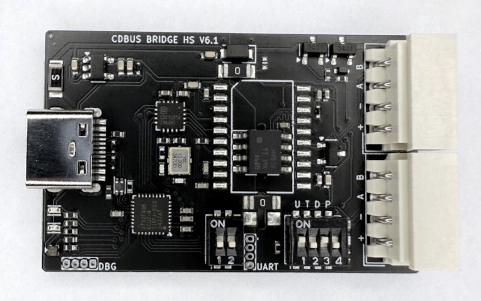
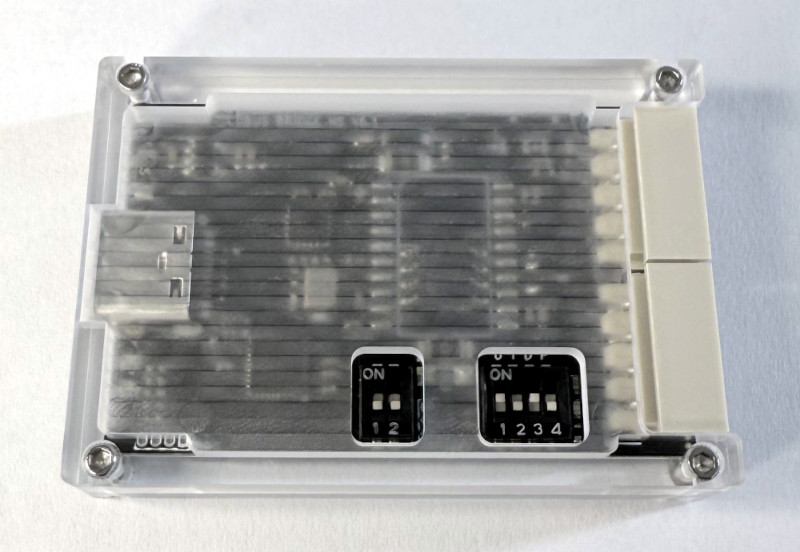
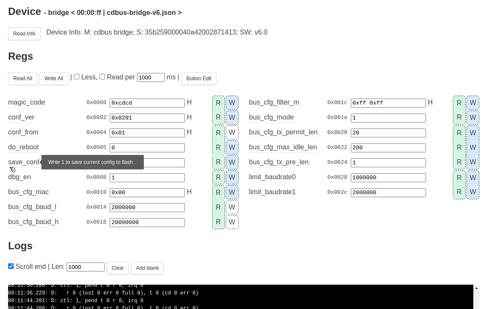

## CDBUS Bridge

The `CDBUS Bridge HS` is a USB-to-RS485 (CDBUS) adapter. The USB port supports `High-Speed`, and the RS485 interface supports up to 50 Mbps.

  


 - The two RS485 ports are internally straight-through, simplifying wiring.

Switchs Defination:
 - S1.1: Force bootloader mode.
 - S1.2: In arbitration mode, the maximum limit of `baud_l`:  
         OFF: Default 1 Mbps; ON: Default 2 Mbps. (modifiable)
 - S2.1: Enable pull-up resistor.
 - S2.2: Enable termination resistor.
 - S2.3: Enable pull-down resistor.
 - S2.4 (HW v6.2+): When enabled together with S2.3, pulls B to 1.65V,
         allowing signal A to operate as a TTL single-wire serial.
 - S2.5 (HW v6.2+) / S2.4: Enable 5V output (should disable when using external power supply).

## Two Ports, One Firmware

The bridge presents both a serial port and an ethernet port, always, and
either may be used. Nothing has to be reflashed to switch between them.

One of them has the bus at a time: the serial port while it is open, the
ethernet port otherwise. Sending works from either. Opening the serial port
is something you do on purpose, while the ethernet interface tends to come
up on its own, so the serial port wins and the existing tools keep working
without anything being taken down first.

### Serial Port (unchanged)

 - The PC sends complete CDBUS packets (with CRC) via USB serial to the CDBUS Bridge, which forwards them unchanged to the RS-485 bus.
 - Data received from RS-485 is sent unchanged back to the PC via USB serial.
 - The baud rate set by the PC when opening the USB serial port is used for RS-485 (`baud_l` is automatically limited in arbitration mode).
 - Before that, the bus runs at the rate stored in the config, which is what it comes up with after power on.
   Saving the config stores the rates in effect at that moment, so a save
   made while the port is open at 2 Mbps makes 2 Mbps the boot rate.
 - The PC must enable the DTR option on the USB serial port, unless `avoid_dtr`
   is set to 1 (bootloader included). The port is then open whenever USB is
   up: it keeps the bus, so the ethernet port gets no bus traffic, and what
   arrives while no program has it open is queued for the next one.
 - The default RS-485 address of the Bridge is 0. To change it, see below.
 - Raw mode allows arbitrary data transfer without following the CDBUS byte
   format (HW v6.2+). The bus then belongs to the serial port alone and the
   ethernet port reports no carrier.
   The rate is 216 MHz / n (n ≥ 16), 13.5 Mbps at most; any other rate runs
   at the nearest one. Exact above 1 Mbps in 0.5 Mbps steps: 1, 1.5, 2, 3,
   4, 4.5, 6, 8, 9, 12 and 13.5 Mbps. 5 Mbps runs at 5.023 Mbps (+0.47%),
   well within what a uart tolerates.

### Ethernet Port

The whole bus is mapped into `fdcd::/104`: the last 3 bytes of an IPv6
address are the CDNET address `level:net:mac` and the UDP port is the CDNET
port. Talking to a device is therefore plain IPv6 UDP.

 - Linux, macOS and Windows 11 have an in-box driver (CDC NCM), nothing to install.
 - No daemon on the host, and no port to open exclusively: several programs
   can use the bus at the same time.
 - Bus traffic goes here whenever the serial port is not open. Close it, or
   leave it alone, and the ethernet port has the bus.
 - A host that is not reading the port (interface down, driver not bound)
   is noticed within 200 ms; bus traffic is then dropped rather than queued
   for it, and queuing resumes the moment the host reads again.
 - The bus comes up at the rate stored in the config, so the serial port
   does not have to be opened once just to pick a rate for this one. To
   change it, write `bus_cfg_baud_h`, save and power cycle.
 - The address the host holds *is* the bridge's identity on the bus, so it
   has to match `bus_cfg_mac` and `net` on the device (`00` and `00` by
   default).
 - A CDNET packet has to fit in one CDBUS frame and there is no
   fragmentation, so keep datagrams at 244 bytes or less.
 - `port_offset` shifts the host's own port: a program binds
   `port_offset + <CDNET port>` and is that CDNET port on the bus. It is
   `0xcd00` (52480) by default, so a level 0 port, which is under 128, needs
   no root to bind; 0 switches the shift off. A datagram sent from a port
   below the offset is dropped, so bind explicitly rather than rely on an
   ephemeral port.

It needs a one-time host setup, see [fw_bridge/host/](fw_bridge/host/). Until
that is done the serial port works as it always has, so the ethernet port is
opt-in.

```python
s = socket.socket(socket.AF_INET6, socket.SOCK_DGRAM)
s.bind(("fdcd::80:0", 0xcd00 + 40))     # port_offset + CDNET port 40
s.sendto(b"...", ("fdcd::80:00fe", 0xcdcd))
```

## Configuration

CDBUS GUI Tool: https://github.com/dukelec/cdbus_gui

The same services (port 1: device info, port 5: config status area, port 8:
flash) are reachable two ways:

 - **Serial**: open the port with the baud rate `52685` (`0xcdcd`) and set
   the target address to `00:00:ff`. The bus is not touched while the port
   is in this mode.
 - **Ethernet**: `fdcd::10:0`, the one address inside the prefix that never
   reaches the bus. It is a node the firmware serves itself, and it answers
   to whichever of the host's addresses the request came from.

After modifying the configuration, write 1 to `save_conf` to save the changes to flash.

To restore the default configuration, change the value of `magic_code` to a different value, save it to flash, and then power cycle the device.

The `HW` field of the info string is kept in the user system data of the MCU,
`tools/hw_ver.py --ver 6.2` writes it through the app; it reads `v6` while never written.




## Download Source Code

```
git clone --recursive https://github.com/dukelec/cdbus_bridge
```

For other hardware versions, please switch to the corresponding branch.

The `tinyusb` submodule is pinned at an upstream commit rather than at a
release tag, because `0.21.0` predates a batch of `usbd.c` fixes for ways
the device can wedge until it is replugged. On top of that `make` applies
the patches in `fw_bridge/patches/tinyusb/` (a dwc2 fix for a device that
stays suspended after the host wakes up) and leaves them applied; `make
tinyusb-unpatch` takes them out before the submodule is moved. Nothing
extra to run.

## Test

```
git clone --recursive https://github.com/dukelec/cdbus_tools
```

```
cd cdbus_tools/
./cdbus_terminal.py --help
```

We can also use a generic serial debugging tool for loopback testing. For example, to simulate node 02 sending a packet to node 00 (with CRC):
```
02 00 01  cd  c1 99
```

If the hardware works properly, the same packet should be received.

